# Projeto AC4 Poo 
Luã Japiassu Macedo Maia: 202607092245

Pietro


## Descrição do projeto

Aplicação Spring Boot (Maven, Java) para uma empresa de brinquedos esportivos para crianças de até 15 anos. Os brinquedos são cadastrados, consultados, atualizados e excluídos (CRUD) por endpoints REST em `localhost:8080/brinquedos`, testados no Postman. Os dados ficam na tabela `TDS_TB_BRINQUEDOS` do banco H2, com as colunas Id, Nome, Tipo, Classificacao, Tamanho e Preco.

O Postman envia a requisição para o `BrinquedoController`, que chama o `BrinquedoService`. O Service usa o `BrinquedoRepository` para gravar e buscar os dados no banco H2.

## Repository

```java
@Repository
public interface BrinquedoRepository extends JpaRepository<Brinquedo, Long> {
}
```

O `BrinquedoRepository` é uma interface que estende `JpaRepository<T, K>`, onde:

- **`T = Brinquedo`**: a entidade (tabela) que o repositório gerencia;
- **`K = Long`**: o tipo da chave primária (`id`).

Não é preciso escrever métodos nem SQL: o Spring Data JPA cria a implementação automaticamente e ela é injetada no `BrinquedoService` com `@Autowired`. A anotação `@Repository` marca a classe como camada de acesso a dados.

Métodos do `JpaRepository` usados no projeto:

| Método | O que faz | Usado em |
|---|---|---|
| `findAll()` | busca todos os registros | GET (listar) |
| `findById(id)` | busca um registro pelo id | GET (individual) |
| `save(brinquedo)` | insere ou atualiza e faz o commit no banco | POST e PUT |
| `existsById(id)` | verifica se o id existe | PUT e DELETE |
| `deleteById(id)` | exclui o registro pelo id | DELETE |

## Testes do CRUD (Postman)

Base: `http://localhost:8080/brinquedos`

### Create: POST `/brinquedos/criar`

Cadastra um brinquedo. O `id` é gerado automaticamente.

```json
{
    "nome": "Bola de Futebol",
    "tipo": "BOLA",
    "classificacao": "5+ anos",
    "tamanho": "N3",
    "preco": 59.9
}
```

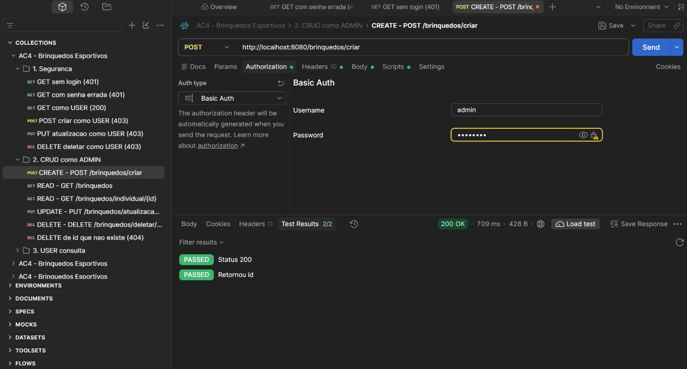

### Read: GET `/brinquedos`

Lista todos os brinquedos cadastrados.

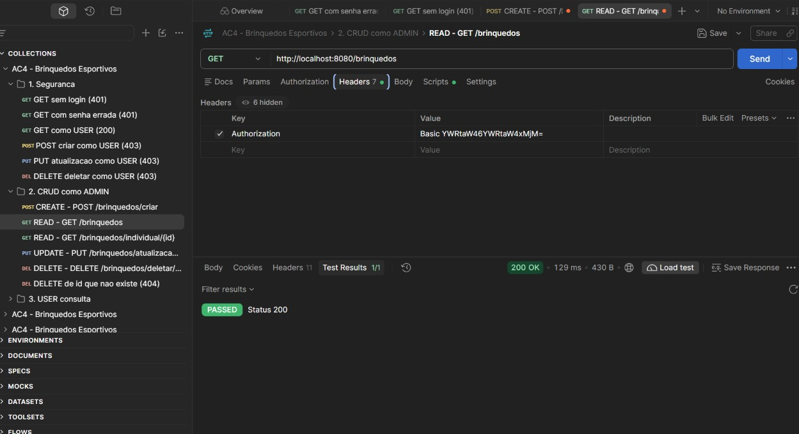

### Read: GET `/brinquedos/individual/1`

Busca o brinquedo pelo id.

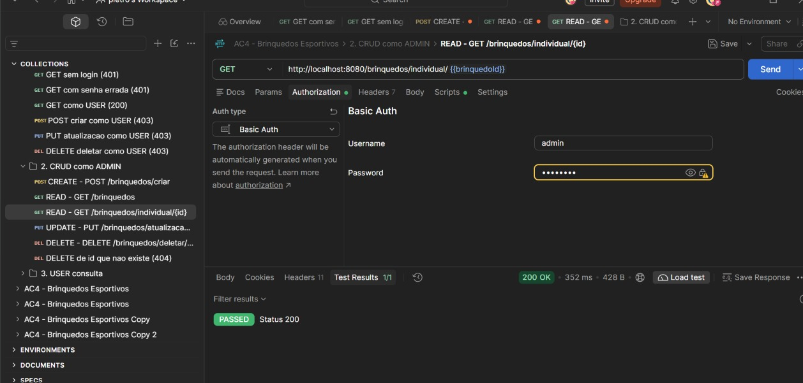

### Update: PUT `/brinquedos/atualizacao/1`

Atualiza os dados do brinquedo de id 1.

```json
{
    "nome": "Bola de Futebol Pro",
    "tipo": "BOLA",
    "classificacao": "8+ anos",
    "tamanho": "N5",
    "preco": 89.9
}
```

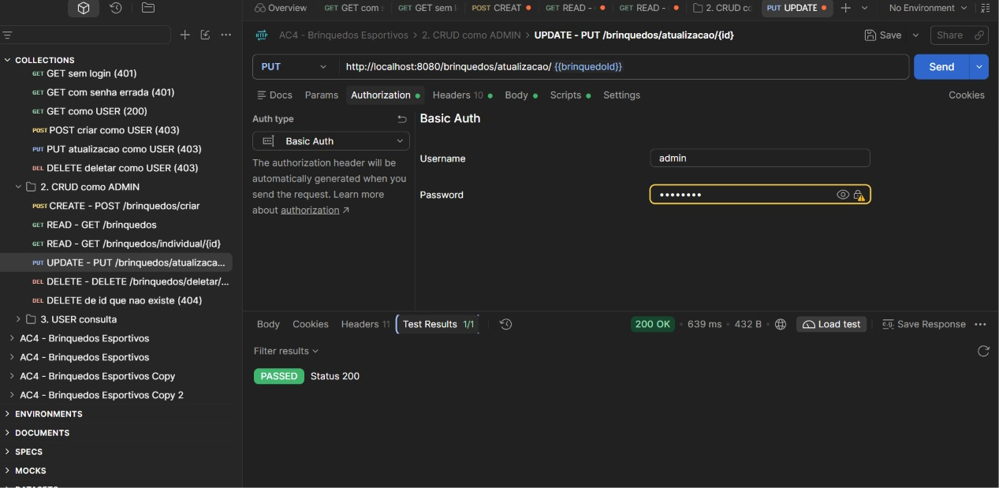

### Delete: DELETE `/brinquedos/deletar/1`

Exclui o brinquedo do banco pelo id. Retorna `200` com `"Brinquedo deletado com sucesso!"`, ou `404` com `"Brinquedo não encontrado."` se o id não existir.

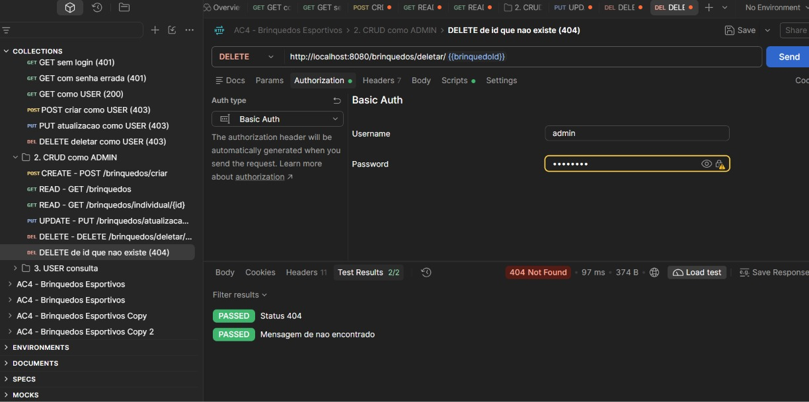

## Validações (Bean Validation)

Os atributos do `Brinquedo` usam anotações do Jakarta Bean Validation, e o `BrinquedoController` usa `@Valid` no POST e no PUT. Se algum dado for inválido, a API responde `400 Bad Request` com a mensagem do erro e o brinquedo não é salvo.

| Atributo | Validação | Mensagem |
|---|---|---|
| `nome` | `@NotBlank`, `@Size(max = 50)` | O nome é obrigatório |
| `tipo` | `@NotNull` | O tipo é obrigatório |
| `classificacao` | `@NotBlank`, `@Size(max = 20)` | A classificação é obrigatória |
| `tamanho` | `@NotBlank`, `@Size(max = 20)` | O tamanho é obrigatório |
| `preco` | `@NotNull`, `@Positive` | O preço deve ser maior que zero |

Exemplo: POST `/brinquedos/criar` (como `admin`) com nome vazio e preço negativo:

```json
{
    "nome": "",
    "tipo": "BOLA",
    "classificacao": "5+ anos",
    "tamanho": "N3",
    "preco": -5
}
```

Resposta `400 Bad Request`, com os erros `nome: O nome é obrigatório` e `preco: O preço deve ser maior que zero`.

## Spring Security

Classe `SegurancaConfig`. A API (`/brinquedos/**`) usa HTTP Basic, para testar no Postman, e o site usa a tela de login (`/login`). Existem dois perfis, criados em memória, com senha em BCrypt:

| Usuário | Senha | Perfil | Pode |
|---|---|---|---|
| `user` | `user123` | USER | consultar (GET) |
| `admin` | `admin123` | ADMIN | consultar, criar, atualizar e excluir |

| Rota | Acesso |
|---|---|
| `/`, `/login`, `/css/**` | público |
| `GET /brinquedos/**` | USER ou ADMIN |
| `POST`, `PUT`, `DELETE /brinquedos/**` | somente ADMIN |
| `/painel` | usuário logado |
| `/painel/admin/**` | somente ADMIN |

Sem login a API responde `401`. Logado sem permissão, responde `403`.

## Thymeleaf

Controller `PaginaController` e páginas em `src/main/resources/templates`:

| Página | Rota | Acesso |
|---|---|---|
| `index.html` | `/` | público (landing page) |
| `login.html` | `/login` | público |
| `painel.html` | `/painel` | logado; o formulário de cadastro e o botão Excluir só aparecem para ADMIN (`sec:authorize`) |

O painel usa o `BrinquedoService` para listar, cadastrar e excluir.

## Testes de segurança (Postman)

Importar `postman/AC4-Brinquedos.postman_collection.json` e rodar a coleção. Cada requisição tem um teste automático do status esperado.

| Requisição | Usuário | Esperado |
|---|---|---|
| GET `/brinquedos` | sem login | 401 |
| GET `/brinquedos` | `admin` com senha errada | 401 |
| GET `/brinquedos` | `user` | 200 |
| POST `/brinquedos/criar` | `user` | 403 |
| PUT `/brinquedos/atualizacao/1` | `user` | 403 |
| DELETE `/brinquedos/deletar/1` | `user` | 403 |
| POST `/brinquedos/criar` | `admin` | 200 |
| GET `/brinquedos` e `/brinquedos/individual/{id}` | `admin` | 200 |
| PUT `/brinquedos/atualizacao/{id}` | `admin` | 200 |
| DELETE `/brinquedos/deletar/{id}` | `admin` | 200 |
| DELETE de id que não existe | `admin` | 404 |

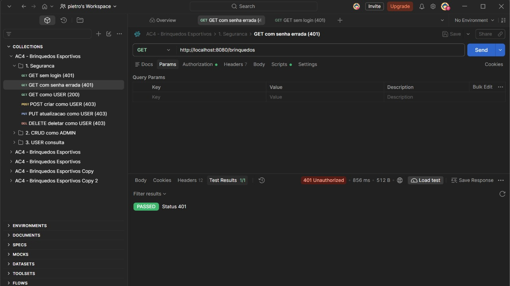

## Prints Spring Initializr


## Prints dos testes de segurança

Os testes de segurança usam HTTP Basic com os usuários `user` (perfil USER) e `admin` (perfil ADMIN). Sem login a API responde 401, e com login sem permissão responde 403.

**Sem login: 401**

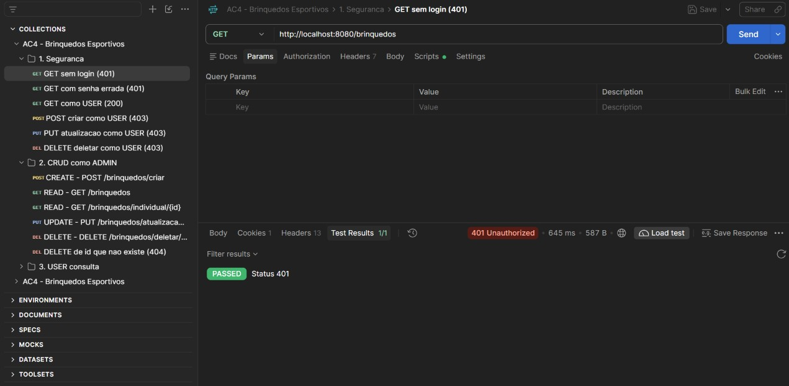

**Usuário USER consegue consultar: 200**

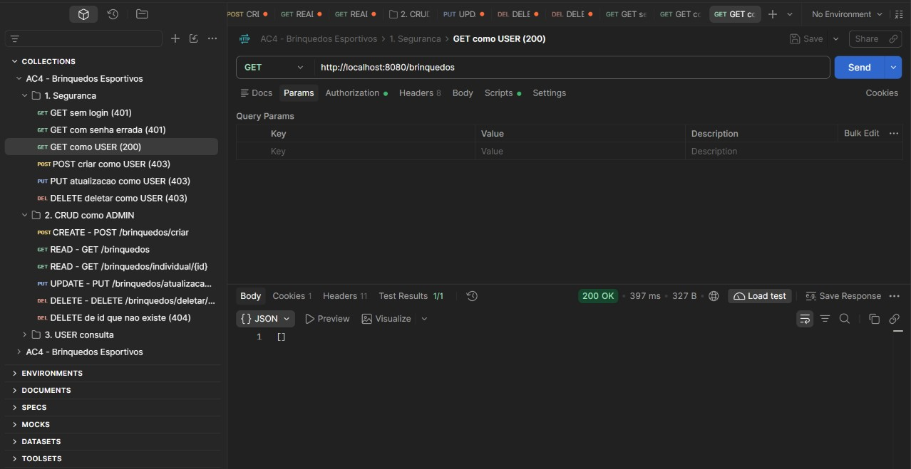

**Usuário USER não consegue criar, atualizar nem excluir: 403**

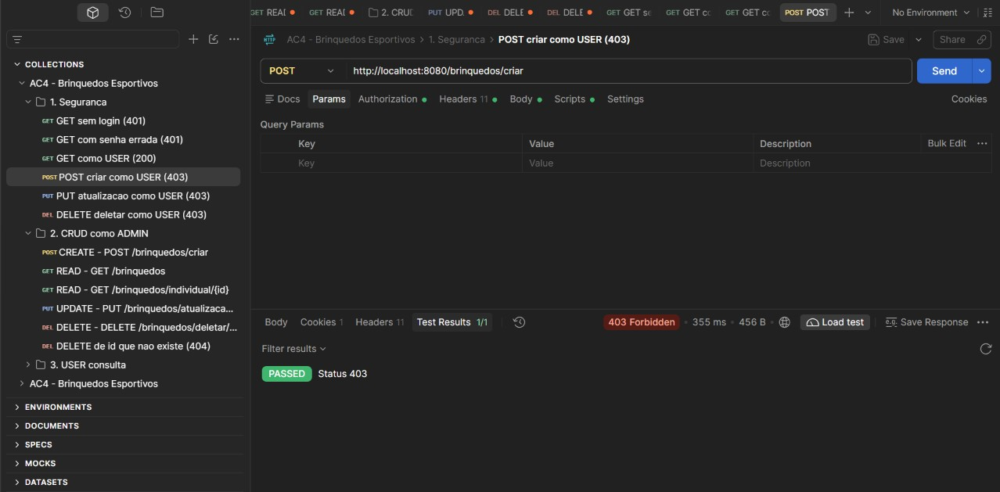


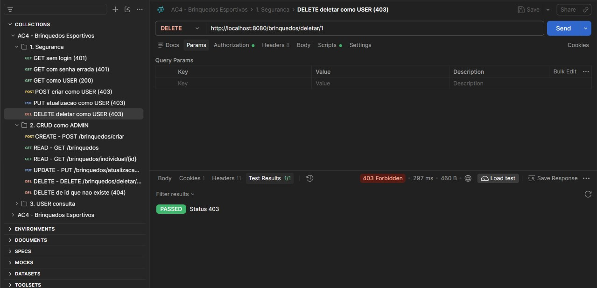

**Usuário ADMIN consegue excluir: 200**

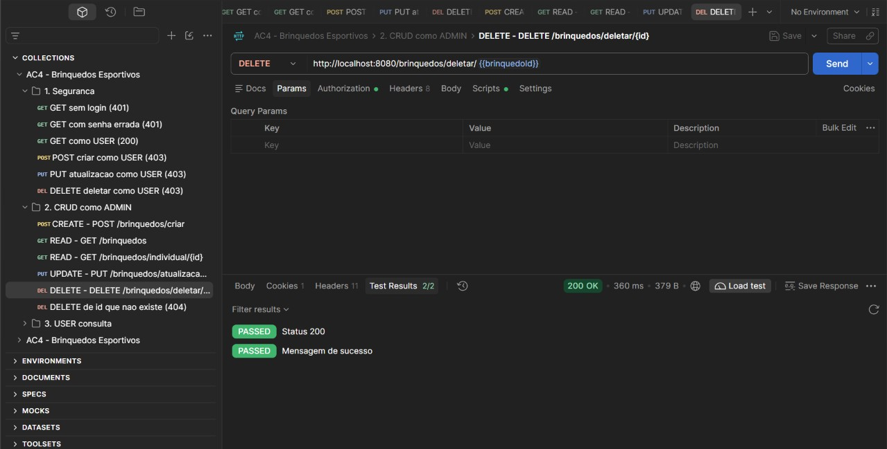

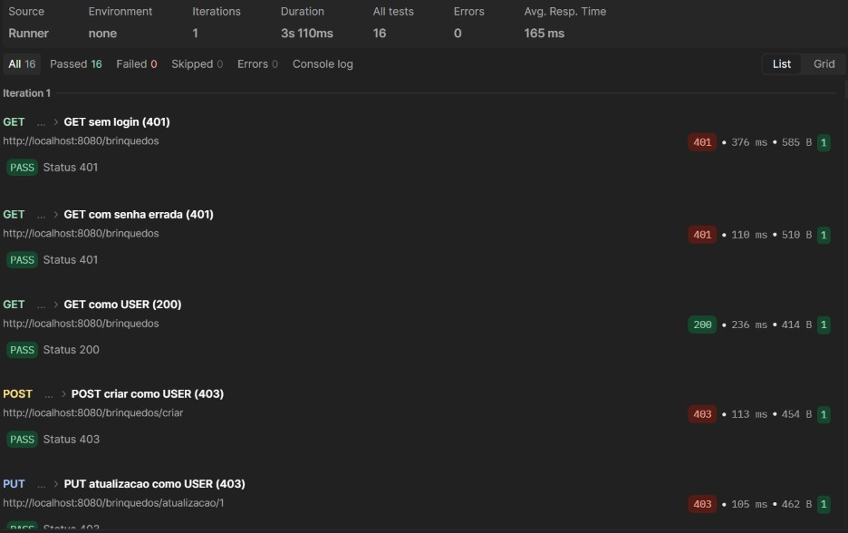

## Telas do site (Thymeleaf)

**Página inicial (pública)**

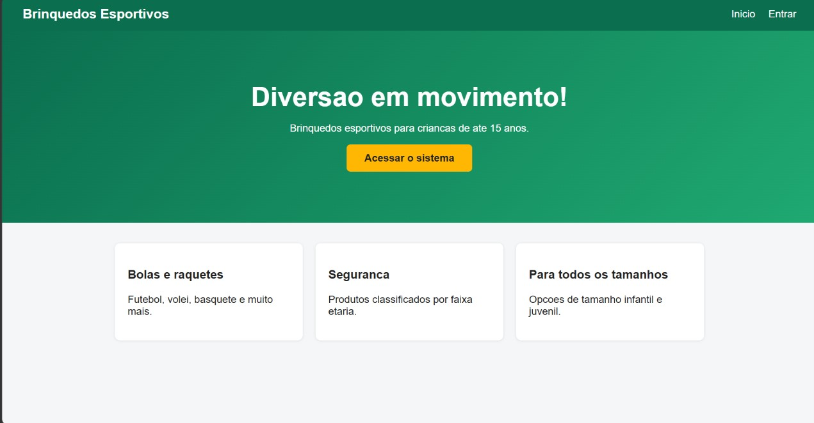

**Login**

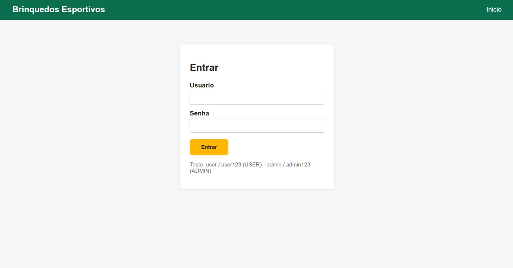

**Painel como ADMIN:** o formulário de cadastro e o botão Excluir aparecem.

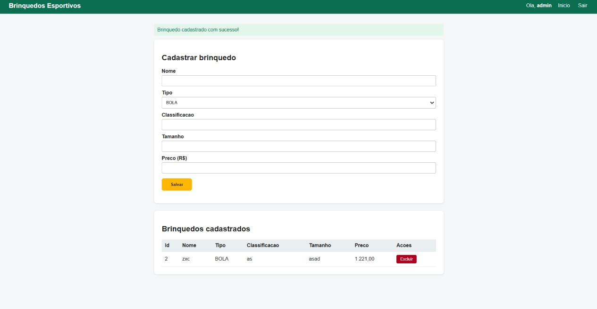

**Painel como USER:** só a lista de brinquedos, sem formulário e sem botão Excluir (`sec:authorize`).

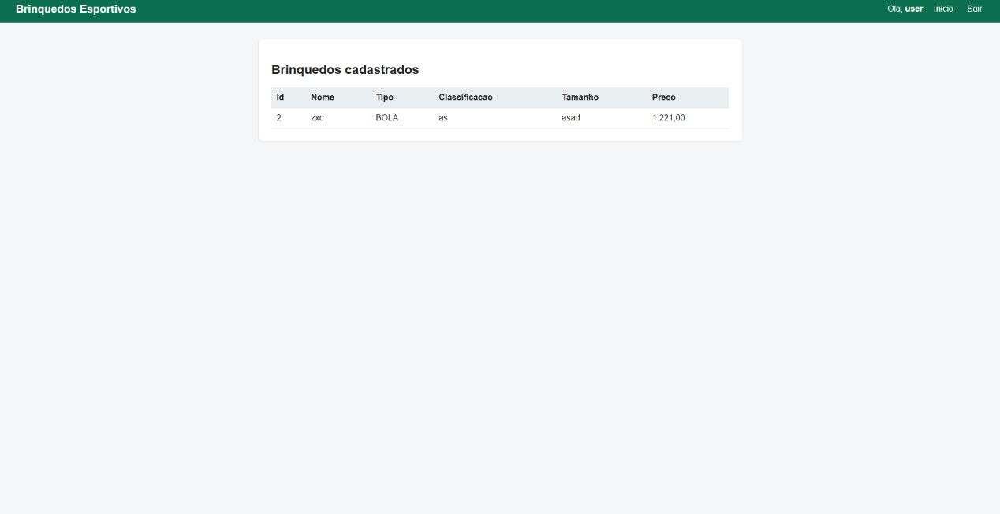


## Diagramas

### Arquitetura em camadas

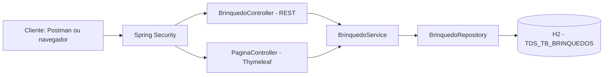

### Fluxo de autenticação e autorização

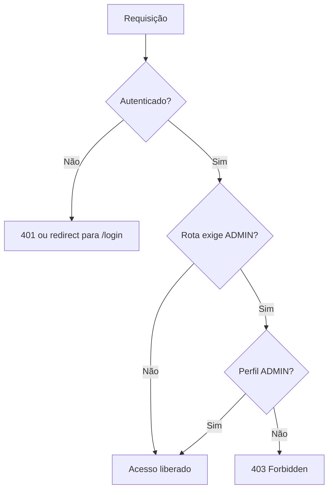

### Permissões por perfil

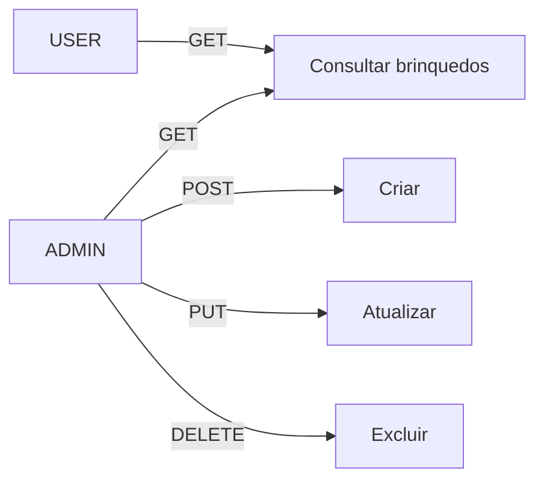

